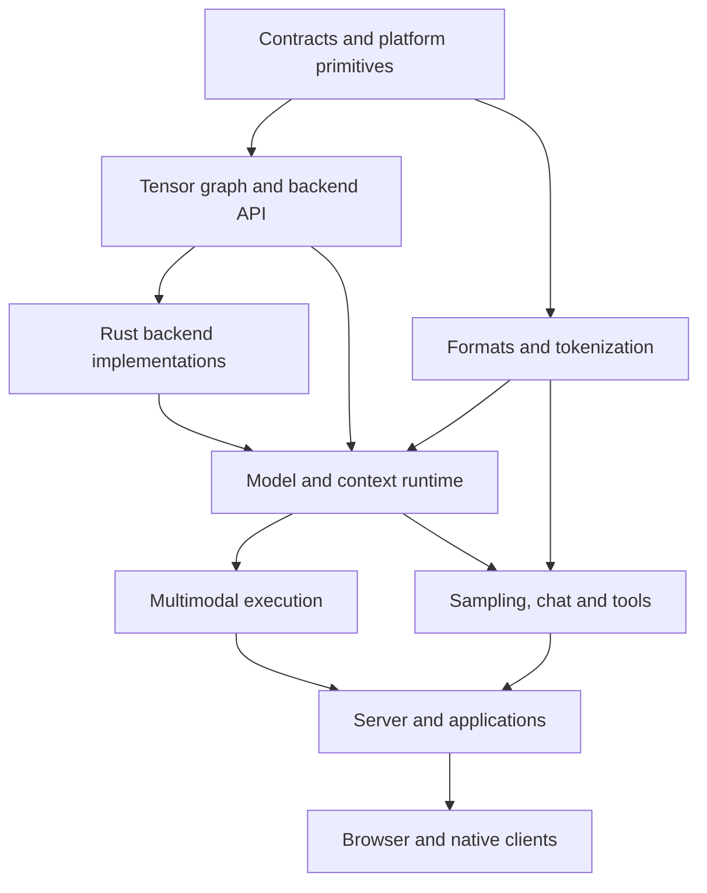

# llama.cpp → Rust: complete rewrite plan with 12 agent tracks

**Prepared:** 8 November 2026  
**Baseline:** the uploaded `llama.cpp-master.zip`, identified by SHA-256 below  
**Host compiler:** the uploaded Rust 1.99.1 distribution, verified locally  
**Status:** original planning baseline; implementation is now in progress. See [PORT_STATUS.md](PORT_STATUS.md) for current evidence and open requirements.  
**Objective:** replace every project-owned implementation in the snapshot with Rust, preserve its functionality and backend coverage, and deliver an independently buildable Rust library and applications.

**Reading guide:** [12 work orders](#5-the-12-agent-work-orders) · [backend matrix](#6-mandatory-backend-implementation-and-proof-matrix) · [milestones](#7-dependency-order-and-integration-milestones) · [release checklist](#10-final-release-checklist) · [inventories](#appendix-b-numeric-model-and-compiler-inventories)

## Executive decisions

1. **There are exactly 12 implementation tracks.** Each has one accountable owner, explicit source responsibility, interface dependencies, deliverables and acceptance evidence. The tracks are not assumed to have equal workload.
2. **All 18 backend families remain in scope.** Optional, experimental, uncommon, remote and DSP backends are included. Difficulty creates an unresolved work item, never an automatic exemption.
3. **The implementation target is 100% Rust-authored project code.** This includes kernels, converters, server, UI behavior, clients, tests, generators and substantive build/release logic. Rust wrappers around the existing llama/ggml implementation do not meet the target.
4. **GPU/DSP programs need a deliberate compilation strategy.** Use Rust device code or a typed kernel representation authored in Rust. Device binaries and generated shading languages are derived build outputs. Copying existing foreign-language kernels into Rust strings is prohibited.
5. **Preserve the frozen archive's behavior before optimizing it.** Keep an isolated reference build and independent reference outputs outside the delivered Rust product. Exact formats, numerical behavior, API behavior, model support and performance have separate acceptance criteria.
6. **Platform dependencies are visible.** Operating systems, browsers, hardware drivers, firmware, compilers and separately supplied vendor APIs are external boundaries. Rewriting the project's backend does not rewrite those vendors' implementations. If “all runtimes” means those external proprietary implementations too, this archive cannot establish that broader result.
7. **A complete release requires all mandatory gates to close.** CPU-only milestones are useful intermediate results. Missing hardware, unavailable source, unresolved compiler support or missing features block the full-completion claim.

The remaining non-Rust files are documented non-code material: licenses, documentation, Cargo/platform manifests, model and test data, media assets, and generated distribution artifacts. The enforceable goal is zero maintained non-Rust implementation, rather than renaming every data file to `.rs`. Some fixture/template/metadata classes necessarily contain more than a literal handful of files.

## 1. Verified inputs and what was actually checked

### 1.1 Archive identity

| Input | Size | SHA-256 |
| --- | ---: | --- |
| `llama.cpp-master.zip` | 41,458,461 bytes | `2db1e23f619fcabfd628481683c57b1e3e90db86bd045900a04b6073e1843122` |
| `rust-1.99.1-x86_64-unknown-linux-gnu.tar.xz` | 210,515,736 bytes | `231fcae47ee950621374725b5fc3b5441d2fbda2955ac45dd7dc816d8876cfe7` |

The source archive contains **4,082 regular files**, totaling **183,804,212 uncompressed bytes**. Its 4,479 ZIP entries also include directories. No Git commit identity was established from the archive; the ZIP comment is empty. The archive checksum is therefore the authoritative baseline, not an assumed current upstream `master` commit. The root CMake file declares a `0.9.0` base version with development builds enabled. [S01]

The inspection covered the complete file inventory, build registrations, architecture/type/operator registries, public interfaces, backend layouts, application/conversion trees, tests and representative implementations. It was a planning audit, not a line-by-line proof of the entire source.

### 1.2 Supplied compiler validation

The supplied distribution was unpacked into an isolated local toolchain. Its actual output was:

```text
rustc 1.99.1 (58cf8f9c3 2026-10-13)
commit-hash: 58cf8f9c35b355199727627d07ae34a4e2846d67
host: x86_64-unknown-linux-gnu
release: 1.99.1
LLVM version: 23.1.1
cargo 1.99.1 (5f94df478 2026-08-27)
```

An isolated, dependency-free Rust 2024 smoke crate successfully completed:

| Command | Observed result |
| --- | --- |
| `cargo generate-lockfile --offline` | Exit 0 |
| `cargo check --offline --locked` | Exit 0 |
| `cargo test --offline --locked` | Exit 0; 1 test passed |
| `cargo build --release --offline --locked` | Exit 0; produced `.rlib`, `.a` and `.so` libraries |

The smoke crate exercised native compilation/linking, a C-compatible exported function, a fixed-layout descriptor and basic floating-point execution. It is **not part of the rewrite** and demonstrates no llama model or accelerator parity.

The upload supplies the Linux x86-64 standard library. Its component list does not include `rust-src` or `rustc-dev`; listing a compiler target does not install that target's libraries or SDK. No CUDA, HIP, Metal, Vulkan, browser, mobile or DSP build was validated during planning. [S02]

### 1.3 Measured implementation surface

| Surface | Measured snapshot scope | Counting qualification |
| --- | ---: | --- |
| All archived regular files | 4,082 | Includes code, tests, docs, build files and assets |
| Selected implementation-language files | 3,388 | Extension-based screening, not a semantic code classification |
| Physical lines in those files | 1,293,116 | Includes comments, generated tables, vendored code and tests; not production logical LOC |
| Backend families | 18 | CPU plus 17 registered accelerator/vendor/remote families |
| Architecture enum entries | 173 | Includes `LLM_ARCH_UNKNOWN`; 172 named entries |
| `src/models/*.cpp` | 176 | Source-file count, not a count of independent supported architectures |
| GGML operation IDs | 102 | Includes `NONE`; excludes the `COUNT` sentinel; also 22 unary and 7 GLU variants |
| Active GGML dtype names | 36 | Numbered within 44 slots; removed/reserved IDs must remain reserved |
| Multimodal model-builder `.cpp` files | 58 | Includes audio and generation, as well as vision |
| `conversion/` Python files | 118 | In addition to the root converter entry points |
| Conversion dispatch aliases | 314 text / 91 projector | Aliases are not distinct model architecture counts |
| Browser UI files | 938 | Includes 479 TypeScript and 404 Svelte files |
| Tool directories / example directories | 20 / 29 | Every directory is assigned below |

The selected source-extension set was `.c .cpp .h .hpp .cu .cuh .m .metal .cl .comp .glsl .wgsl .s .py .ts .js .svelte .swift .kt .kts .sh .bat .ps1`. Other executable/configuration forms still require semantic review; this screening count is not the completeness denominator. [S01–S08]

## 2. Completion contract and language policy

### 2.1 Code that must become Rust

This applies to project-owned and bundled implementation, including:

- The llama public library, model graphs, runtime/context state and all GGML computation.
- Every backend's host implementation, custom kernels, schedulers, helpers and generators.
- Python converters and GGUF utilities, including the metadata editor's functionality.
- Chat templates' interpreter, grammar machinery, sampling and speculative decoding.
- Multimodal preprocessing, model adapters, audio generation, media probing/decoding and resampling.
- HTTP server, model router, tools/MCP integrations, browser application, native example applications and command-line tools.
- Tests, benchmarks, development helpers, model-slicing scripts and substantive packaging/release automation.
- Bundled HTTP, JSON, image, audio, process, hashing and JavaScript functionality.

Audited Rust dependencies may replace commodity implementations. A crate's `.rs` interface is insufficient evidence: inspect its enabled features, build dependencies, bundled source, linked libraries and subprocesses. A crate that compiles the old llama/ggml source, embeds old kernels or silently brings in a foreign application runtime fails the contract.

### 2.2 Files that remain non-Rust for a defined reason

| Class | Treatment |
| --- | --- |
| Markdown, license/notice text, authorship records | Retain and update; preserve required attribution |
| Cargo manifests/lockfile, CI entry metadata, platform/app manifests | Minimal declarative configuration; substantive logic lives in Rust tasks |
| GGUF, tokenizer fixtures, JSON test inputs, model metadata, media and icons | Keep their actual formats; record source, license, hash and purpose |
| Jinja templates and GBNF examples | Treat as supported input data; implement their interpreter/parser in Rust |
| Generated C headers, shader text, PTX/SPIR-V, WASM glue, platform descriptors and binaries | Derive reproducibly from authoritative Rust/data; label generated, hash and never hand-edit |
| Original C/C++/Python/JS reference tree | Isolated comparison input only; absent from the Rust product's source/build/package dependency graph |

A path allowlist records each retained non-Rust item and its role. An extension allowlist alone is insufficient: an opaque original JS bundle hidden in JSON, base64 or Rust strings is still a foreign implementation.

If an external SDK requires device source such as MSL or OpenCL C, Rust must generate it from typed Rust kernel semantics. This is a compiler output boundary, not permission to keep an independently maintained foreign-language implementation.

### 2.3 External platform boundary

The product may communicate with OS APIs, browser APIs, hardware drivers and separately installed vendor APIs through Rust declarations. Examples include CUDA driver interfaces, Metal, Vulkan, OpenCL, CBLAS providers, ACL/ACLNN, IBM zDNN and OpenVINO. Every such dependency must be named in the release manifest with its function and linkage mode.

This permits rewriting a backend's implementation in Rust while using the same external device service that the original backend used. It does **not** permit linking the original ggml backend, adding a project C++ shim, or describing a vendor library as having been rewritten in Rust. Native vendor math/graph implementations must remain explicitly identified, including optional cuBLAS/oneDNN-style acceleration.

The default CPU library must function without native vendor math, legacy llama binaries, Python, Node or FFmpeg. Optional vendor backends keep their declared external SDK dependencies. The strict project-code audit and the external-dependency inventory are separate release checks.

### 2.4 Parity boundary

Preserve every capability actually present in the frozen snapshot, including supported optional configurations and documented fallback behavior. Do not invent support for combinations the reference itself rejects. Conversely, a newly missing implementation must not be mislabeled “unsupported by design.”

Unlimited third-party Python remote code, an unspecified FFmpeg plugin build, and an external `llama-connect` executable are not fully described by this ZIP. They remain explicit compatibility/source-discovery gates. The plan does not waive them or claim the archive establishes their entire behavior.

## 3. Exactly 12 tracks and initial source ownership

The following initial primary-owner assignment was checked against **all 4,082 files**, with one owner per path. Counts include colocated docs/tests/build files and measure responsibility, not equal effort. In particular, T01 owns important cross-project contracts despite its small original-file count; T08 and T11 need substantial work packages and assistance.

| Track | Accountable responsibility | Initially assigned files | Proposed Rust workspace areas |
| --- | --- | ---: | --- |
| **T01** | Workspace contracts, public ABI, platform foundations and integration decisions | 8 | `contracts`, `platform`, `llama-ffi`, `llama` facade |
| **T02** | Tensor engine, graphs, allocation, scheduler, backend interfaces, autograd/optimizers | 19 | `tensor`, `graph`, `backend-api`, `scheduler`, `optim` |
| **T03** | CPU kernels, quantization formats and all CPU instruction-set paths | 79 | `quant`, `backend-cpu`, `cpu-kernels` |
| **T04** | GGUF/checkpoint IO, conversion, vocabulary/tokenization and Unicode | 252 | `gguf`, `checkpoint`, `convert`, `tokenizer`, `unicode` |
| **T05** | Model architectures, inference execution, contexts, caches and adapters | 218 | `models`, `runtime`, `memory`, `adapters` |
| **T06** | CUDA, HIP and MUSA host/device implementations | 295 | `backend-cuda`, `backend-hip`, `backend-musa`, device crates |
| **T07** | Metal, Vulkan, OpenCL and WebGPU; shared Rust kernel representation | 601 | `kernel-ir`, `kernel-codegen`, four backend crates |
| **T08** | Specialty/vendor backends and remote/virtual execution | 571 | BLAS, CANN, ET, SYCL, zDNN, Hexagon, ZenDNN, OpenVINO, RPC, VirtGPU |
| **T09** | Multimodal models, image/audio/video processing and speech generation | 108 | `multimodal`, `media`, `audio`, `tts` |
| **T10** | Sampling, grammar/chat/common behavior, CLI tools, unified app and general examples | 378 | `sampling`, `grammar`, `chat`, `common`, `cli`, tool binaries |
| **T11** | Server, browser UI, native clients, tunnel integration and GUI presentation | 1,106 | `server`, `web-ui`, `native-apps`, `connect` |
| **T12** | Validation, inventory closure, Rust build tasks, packaging, documentation and release | 447 | `conformance`, `fixtures`, `benchmarks`, `xtask`, release metadata |
| **Total** | Complete initial ownership | **4,082** | One workspace with explicit dependency boundaries |

Crate names are design names, not already-created packages. Use a small number of crates where separation provides useful compilation, platform or ownership boundaries; do not create a crate for every original file.

Every path also receives a separate disposition: `rewrite`, `replace-with-audited-rust`, `retain-data-or-docs`, `generate`, or `superseded-build-plumbing`. A disposition must link to the capability replacing that path. “Deleted” by itself is never a proof of completed functionality.

## 4. Target architecture and shared contracts

### 4.1 Dependency direction



The conformance harness observes all layers but is not a runtime dependency. Device compiler workspaces may have separate toolchain pins while sharing versioned Rust kernel/ABI definitions. Host production crates stay pinned to Rust 1.99.1 unless a concrete compatibility finding requires a documented toolchain change.

### 4.2 Contracts to freeze at the first milestone

| Contract | Owner / reviewers | Required invariants |
| --- | --- | --- |
| `TensorDesc` / `DType` | T02 / T03, T04, T06–T09 | Preserve numeric type IDs, four-dimensional shape semantics, byte strides, quantized block layout, views, bounds/alignment and checked size arithmetic |
| `Buffer` / `AllocationPlan` | T02 / all backend owners | Host/device/pinned/mapped/shared allocation are distinct; grouped allocations and imported buffers have explicit ownership |
| `Backend` / `DeviceCaps` | T02 / T06–T08 | Capability is a function of op, dtype, shape, strides, parameters and actual device; report pending/unsupported/error distinctly |
| `ExecutionPlan` / `Submission` | T02 / T05–T09 | A submission keeps every buffer, parameter and workspace alive through completion; alias conflicts, synchronization and cancellation are explicit |
| `ModelSource` / `TensorReader` | T04 / T05, T09 | Bounded lazy/sharded reads, validated offsets, endian conversion, stable names/metadata and cancellation; mapped storage outlives borrowed tensor views |
| `ModelDescriptor` / `GraphBuilder` | T05 / T02, T04, T09 | Architecture-specific metadata and graph topology remain observable; no generic transformer assumption for recurrent, diffusion or audio models |
| `SequenceState` / `MemoryTransaction` | T05 / T02, T10, T11 | State updates commit on successful execution; rollback after cancellation/error/speculative rejection; recurrent and attention state are separate |
| `Tokenizer` / `TokenId` | T04 / T05, T09, T10 | Exact token IDs/bytes, normalization, special-token rules and source-defined buffer/length behavior |
| `Sampler` / `Grammar` / `ChatTemplate` | T10 / T04, T05, T11 | Explicit order and RNG state; incremental input; clone/reset/accept semantics; deterministic formatting and structured-output behavior |
| `InputChunk` / `EmbeddingBatch` | T09 / T05, T10, T11 | Modalities, positions, timestamps, sample rate and per-sequence generation state have typed ownership |
| `Request` / `Event` / `Cancellation` | T11 / T05, T10 | Bounded queues, backpressure, inference-thread ownership, resumable stream offsets and teardown rules |
| FFI/plugin/protocol tables | T01 / T02, T08, T12 | Fixed ABI layouts, version negotiation, validated discriminants, ownership callbacks and no Rust trait objects across shared-library or wire boundaries |

The snapshot uses `GGML_MAX_DIMS=4`, `GGML_MAX_SRC=10`, `GGML_MAX_OP_PARAMS=64` and backend ABI version **3**. Preserve compatibility where exposed; do not serialize native Rust memory layout. RPC has its own wire contract and must not inherit an accidental Rust ABI. [S03, S09]

### 4.3 Ownership, concurrency and error rules

Weights and model descriptions are shareable immutable objects. Mutable inference state belongs to contexts/sequences. Backend buffers are typed handles with explicit access rules; thread safety is justified for each handle rather than asserted with blanket unsafe `Send`/`Sync` implementations.

Use safe Rust for parsing, planning, routing, registry logic and ordinary algorithms. Constrain `unsafe` to small audited FFI, memory-mapping, SIMD/device and ABI modules, documenting alignment, bounds, lifetimes and synchronization. Quantized structures are not created by unchecked casts of arbitrary file bytes.

Foreign-call boundaries validate pointers, lengths, enum values, callback lifetimes and ownership. Return compatible errors; prevent unwinding across foreign ABI boundaries. If an artifact uses `panic=abort`, document that `catch_unwind` cannot recover aborts; choose the FFI error/panic policy explicitly.

CPU threading must cover affinity/NUMA, task splitting, cancellation and avoidance of oversubscription when vendor libraries also create threads. Keep blocking inference off the HTTP executor's ordinary request tasks. Model download/conversion uses bounded queues and streaming IO.

### 4.4 Common Rust kernel strategy

T07 owns a versioned typed kernel representation and portable emitters. T03 owns exact quantization layouts. T06 and T08 contribute device-specific types, intrinsics and lowering rules through reviewed extensions.

The representation must express address spaces, scalar/vector/tile types, workgroup/subgroup synchronization, atomics, rounding, quantized loads, noncontiguous addressing and device capability requirements. It must also allow target-specific kernels where a universal lowering would sacrifice required functionality or performance.

Prefer direct Rust device compilation when it supports the required hardware and instructions. Where an API consumes shaders, generate them from Rust kernel semantics. Validate generated modules and cache them by source/IR hash, toolchain version, target, device capability set and compiler flags.

Do not treat every SPIR-V module as interchangeable: Vulkan compute and OpenCL/Level Zero compute use different execution environments. Do not assume a general MSL emitter implements Metal's specialized tensor features. [P01–P08]

## 5. The 12 agent work orders

### Track T01 — Contracts, public library/ABI and platform foundation

**Mission:** establish a coherent Rust product and compatibility boundary so the other tracks do not build twelve incompatible libraries.

**Source ownership:** `include/**`; `src/llama.cpp`, `llama-ext.h` and `llama-impl*`/`llama-mmap*`. Review public GGML, backend and multimodal declarations with their domain owners. T12 owns build metadata and the integration automation.

**Deliverables:**

1. Workspace architecture decisions, feature naming, error types, logging/cancellation conventions and a stable public Rust facade.
2. Rust implementations of the public C ABI, including deprecated symbols still exported by the snapshot, callbacks, defaults, string/buffer conventions and library version reporting.
3. Rust platform primitives for mapped/locked files, allocation ownership, dynamic library loading and portability helpers.
4. Generated compatibility headers and versioned dynamic-backend entry tables. Header generation is an output step; the ABI implementation is Rust.
5. A contract-change process and reviewed dependency boundaries for all tracks.

**Dependencies:** T02/T04/T05/T09/T10 supply real functionality behind the facade. The ABI layer must not grow a second inference implementation. T01 supplies initial types before these implementations exist.

**First work package:** inventory every public symbol, enum value, struct layout and callback contract; establish layout tests against the reference's supported target ABIs. Publish contracts v0.1 before broad implementation.

**Exit evidence:** public Rust API examples run; exported symbol/default/layout matrix matches the snapshot; generated C-header consumers work; callback lifetime and allocation/free behavior are tested; no legacy library linkage or panic escaping FFI. T01 also signs off every shared-contract revision.

### Track T02 — Tensor engine, graph execution, allocation and differentiation

**Mission:** replace the GGML engine, including capabilities beyond forward inference.

**Source ownership:** common GGML headers and `ggml/src/ggml*` engine/allocation/backend/scheduler/optimizer files, except quantization, GGUF, device directories and build metadata assigned elsewhere.

**Deliverables:**

1. Typed tensor metadata and storage/view rules; 102 operation-ID contracts plus unary/GLU suboperations, hints and precision modes.
2. Graph construction, graph duplication, allocation planning, graph reuse, backend registration/loading and execution scheduling.
3. Mixed CPU/device execution, copies/events, layer/tensor splitting, pipeline scheduling and transparent fallbacks only where the reference permits them.
4. Group allocation, buffer import/export and asynchronous lifetime handling.
5. Backward graph construction, gradient accumulation, losses, AdamW/SGD and optimization/training support.
6. Host threadpool and scheduling contracts, with platform/CPU implementation work coordinated with T01/T03.

**Dependencies:** T01 types; T03 scalar CPU implementation; T06–T08 backend implementations. T05/T09 exercise realistic graph and state requirements early.

**First work package:** tensor layout plus graph/allocator semantics and a scalar reference executor; exercise views and overlapping buffer lifetimes before adding device scheduling.

**Exit evidence:** operation, aliasing, allocation and gradient tests pass; mixed-device schedules preserve data dependencies; cancellation and repeated graph reuse are sound; training examples can use rewritten differentiation/optimizers. An operation with a stubbed evaluator is not complete because graph construction succeeds.

### Track T03 — CPU kernels, quantization and instruction-set optimization

**Mission:** provide the independent Rust CPU execution path and authoritative numeric/packed-format definitions.

**Source ownership:** `ggml/src/ggml-cpu/**`, `ggml-quants*`, `ggml-common.h`, `ggml/include/ggml-cpu.h` and `src/llama-quant*`. T10 owns CLI presentation; T04 owns checkpoint/GGUF serialization.

**Deliverables:**

1. Scalar kernels covering reference-supported types, operations, strides, views, broadcasting, gradients and padding.
2. Quantize/dequantize and packed dot/matmul paths for every active numeric format, including K/IQ/TQ families, MXFP4, NVFP4, Q1_0, Q2_0 and FP8 E4M3.
3. Importance-matrix handling, block scales, rounding, codebooks, packing/repacking and model requantization behavior.
4. Rust dispatch and optimized paths for x86, ARM, PowerPC, LoongArch, RISC-V, s390 and WASM; include source-present AMX, KleidiAI/llamafile-style paths, tiled kernels and SpacemiT functionality.
5. Cache blocking, prepacking, worker partitioning, NUMA/affinity integration and performance counters.

**Dependencies:** T01/T02 tensor and threading contracts; T04 format invariants; T05 representative model shapes. T06/T07/T08 consume the same quant-format definitions.

**First work package:** exact scalar block codecs and F32/F16/BF16 matmul/reduction/norm/RoPE/attention sufficient for the first CPU vertical slice. Existing optimized native implementations may be comparison oracles, not final dependencies.

**Exit evidence:** exact serialized block layout/ID preservation; reference numeric acceptance; every ISA branch compiled and executed on suitable hardware/emulation with limitations stated; feature detection never emits unsupported instructions on fallback CPUs. Performance includes batch-1 decode, prefill, bandwidth, allocation and representative model workloads.

### Track T04 — GGUF, checkpoint conversion, tokenization and Unicode

**Mission:** make model ingestion, conversion and text encoding independently Rust-native.

**Source ownership:** `conversion/**`, `gguf-py/**`, the four root `convert_*.py` entry points, GGUF core/header, `src/llama-model-loader*`, `llama-model-saver*`, `llama-io*`, `llama-vocab*` and `unicode*`; model/tokenizer fixture data and conversion examples. T11 supplies the editor presentation; T09/T12 own colocated entry scripts and call T04 conversion APIs.

**Deliverables:**

1. One authoritative GGUF reader/writer, metadata/type/endianness implementation, split-file logic, alignment rules and large-file validation.
2. Checkpoint readers for Safetensors and the supported PyTorch ZIP/pickle storage forms; sharded indexes, lazy/mapped/ranged reads and bounded transformations.
3. Rust implementations of all 314 text and 91 projector dispatch aliases and their transformations, including Mistral formats, LoRA, vocab-only, draft/MTP/NextN, tensor fusion and multimodal sidecars.
4. All tokenizer modes, special-token and pretokenizer rules, Unicode normalization/regex behavior, SentencePiece/BPE/WordPiece/Unigram and RWKV/PLaMo variants.
5. Rust replacements for GGUF dump/edit/hash/metadata utilities and model-conversion helpers; shared API for the GUI.
6. A conversion manifest linking every alias to required metadata, transforms, tokenizer extraction and test fixture.

**Dependencies:** T03 quant formats; T05 model schemas; T09 projector/audio schemas; T01 mapped IO. No dependency on the old Python converter in production.

**First work package:** GGUF round-trip and vocabulary fixtures, then a minimal known-model Safetensors conversion. Implement pickle storage parsing as bounded data handling, never arbitrary execution of checkpoint contents.

**Exit evidence:** old/new conversion compares metadata, tensor names/shapes/order/content, alignment and splits; outputs load in both implementations; tokenization/detokenization matches exact IDs and bytes across the bundled corpora and malformed/Unicode edges. Legacy `.bin`, optional flags and GUI operations are included.

**Mandatory gate:** source uses `trust_remote_code` for some tokenizer/configuration paths. Port known required algorithms and specify/test the extension contract. Arbitrary third-party Python execution is not established by a Rust data parser; if that behavior remains required and unresolved, the full compatibility gate stays open. [S06]

### Track T05 — Model architectures, contexts, state and adapters

**Mission:** implement the model/runtime layer across the entire registered architecture set.

**Source ownership:** `src/models/**` and remaining `src/` model/architecture/graph/batch/context/parameter/memory/cache/adapter implementation after T01/T03/T04/T10 exclusions.

**Deliverables:**

1. An exact architecture registry cross-checking 172 named enum entries, 176 model source files, conversion aliases and load/graph dispatch. These sets differ; aliases/helpers and externally represented modalities require explicit mapping.
2. Rust model descriptors, hyperparameters, tensor binding and per-architecture graph builders, including encoders, decoder-only, encoder-decoder, embedding/reranking, MoE, recurrent/SSM, hybrid, diffusion and audio-related backbones.
3. Context processing: normal and extended batches, microbatch splitting, per-sequence positions, logits/embedding selection, encode/decode/process, attention settings and backend sampler attachment.
4. KV/cache and sequence behavior: standard attention, sliding windows, specialized DSA/ISWA/MSA/DSV4 caches, recurrent state, hybrid/indexed state, MoE cache and state save/restore.
5. LoRA/aLoRA, control vectors, adapter composition, pooling, model memory fitting integration and lazy/offloaded experts where supported.
6. Transactional sequence updates, graph cache invalidation and consistent output/error/cancellation behavior.

**Dependencies:** T02/T03 execution, T04 model/tokenizer IO, T06–T08 device coverage, T10 sampling/speculation, T09 multimodal contracts.

**First work package:** one minimal decoder graph plus context/batch/cache, followed immediately by one recurrent or hybrid graph and one encoder path to prevent a transformer-only architecture from hardening.

**Exit evidence:** every architecture dispatch maps to implemented behavior and tests; tensor-level and end-to-end outputs match reference criteria; state operations are round-tripped and compared; batching, multi-sequence reuse, adapters and rollback are exercised. Synthetic tiny models cover graph structure; actual compatible weight fixtures are still required for meaningful model-family acceptance.

### Track T06 — CUDA, HIP and MUSA

**Mission:** replace three related backend families' project-owned runtime and kernel implementation in Rust without confusing shared source with shared hardware semantics.

**Source ownership:** `ggml/src/ggml-cuda/**`, `ggml-hip/**`, `ggml-musa/**` and associated public declarations.

**Deliverables:**

1. Rust device enumeration, allocation, pinned memory, virtual memory, streams/events, graph capture/replay, error handling and kernel/cache management.
2. Rust-authored pointwise/reduction, quantized GEMV/GEMM, tensor-core, attention/fusion, recurrent/MoE and training kernels supported by the reference.
3. CUDA/HIP/MUSA-specific lowering and launch contracts, including warp/wave differences and quantized fragment layouts.
4. Multi-GPU split strategies, peer copies, collectives, graph updates, fallback reporting and cache invalidation.
5. Reproducible device builds with pinned compiler/SDK/device-target metadata and required vendor binding audits.

**Toolchain selection:** evaluate direct Rust NVPTX and NVIDIA CUDA-Rust/CUDA-Oxide. Current official CUDA-Oxide documentation pins **Rust 1.99.1**, but also requires compiler components/SDK tooling absent from the basic upload and currently documents Linux-only support. It is a candidate, not evidence of Windows or old-GPU parity. For HIP, evaluate Rust AMDGPU output/HIP-HSA loading with per-architecture core/device builds. For MUSA, prove a compatible Rust device-output or typed-emitter route before mass translation. [P01–P04]

**Dependencies:** T02 backend/scheduler contracts; T03 quant layouts; T07 shared IR, with T06-owned extensions; T05 realistic workloads.

**First work package:** on each family independently, enumerate a device; allocate/copy; run reduction and quantized matmul; prove the required subgroup/tensor instruction path. CUDA success does not close HIP or MUSA.

**Exit evidence:** per-device supported operation matrix, full-model parity, graph replay and multi-device correctness/performance. No original `.cu`/`.cuh` code or foreign project shim in the delivered build. RTX 4090 batch-1 decode is a useful later benchmark if that device is made available; it is not presumed accessible here and cannot validate other families.

### Track T07 — Metal, Vulkan, OpenCL, WebGPU and shared kernel tooling

**Mission:** provide four fully implemented backends and Rust-authoritative device program generation.

**Source ownership:** `ggml-metal/**`, `ggml-vulkan/**`, `ggml-opencl/**`, `ggml-webgpu/**` and their public headers.

**Deliverables:**

1. Rust host adapters for platform APIs, resource ownership, command queues, synchronization, graph/fusion selection and device capability queries.
2. Versioned Rust kernel IR, validation and source mapping; output modules for the needed shading languages/binaries.
3. Kernel/function parity for the archive's 38 Metal files, 162 Vulkan compute files plus support GLSL, 271 OpenCL files and 47 WGSL files plus templates.
4. Portable and device-specific quantized matmul, attention, cooperative matrix/subgroup paths, images/textures, BF16/FP8 and source-present extensions.
5. Native and browser WebGPU paths with asynchronous mapping, browser limits, errors/device loss and WASM integration.

**Dependencies:** T02/T03 contracts; T06/T08 extension requirements; T11 browser integration.

**First work package:** prove Rust-authored IR through generated artifact to actual device execution on each API, including a noncontiguous quantized operation. Include an early Metal cooperative-tensor probe and OpenCL IL/driver-compiler capability probe.

Naga provides Rust MSL/SPIR-V/WGSL emitters, making it a concrete candidate for portions of the toolchain. Its existence does not prove support for every required extension. The snapshot's Metal implementation uses specialized tensor facilities; source-compatible performance may need dedicated Rust IR nodes and emitters. OpenCL may need generated OpenCL C where IL loading is unavailable. [S10, P05, P08]

**Exit evidence:** independent backend correctness and full-model execution; generated artifact provenance; API validation; supported device/OS/browser matrix; synchronization and specialization-cache tests. Running all four labels through a generic backend without proving equivalent features/performance is not sufficient.

### Track T08 — Vendor, DSP, distributed and virtual backends

**Mission:** cover all remaining ten backend families, with early feasibility work on difficult ABI/device paths.

**Source ownership:** `ggml-blas/**`, `ggml-cann/**`, `ggml-et/**`, `ggml-sycl/**`, `ggml-zdnn/**`, `ggml-hexagon/**`, `ggml-zendnn/**`, `ggml-openvino/**`, `ggml-rpc/**`, `ggml-virtgpu/**`, their public headers and `tools/rpc/**`.

**Work packages:**

1. **BLAS/CANN/zDNN:** Rust adapters, resource/shape/layout transformations, supported-op dispatch and explicit external vendor ABI manifests.
2. **SYCL functionality:** Rust Intel device/runtime dispatch, XMX/DPAS and kernel behavior. Evaluate Level Zero/Unified Runtime C interfaces and native oneDNN Level Zero interoperability. Replacing the implementation route must still preserve the original backend's exposed functionality and supported hardware.
3. **OpenVINO:** Rust GGML-to-vendor graph transformation, quantization/dequantization and state handling; evaluate Rust-generated IR plus vendor C load/compile/infer APIs.
4. **ZenDNN:** audit the snapshot-pinned C++ vendor surface; establish a usable ABI or implement the needed adapter/runtime behavior in Rust. A new project C++ shim is prohibited.
5. **Hexagon:** Rust FastRPC serialization/host stubs, DSP skeleton/kernels, IDL-equivalent contract, ELF/SWIV processing, loading and source-present optimized DSP paths.
6. **ET:** Rust host runtime/device communication and Rust custom RISC-V kernel/startup generation; validate firmware/environment integration and reject unsupported instructions.
7. **RPC/VirtGPU:** Rust client/server and guest/host halves, framing, graph/tensor cache, remoting, RDMA, collectives, shared memory and failure recovery.

**Dependencies:** T01 stable ABI, T02 scheduling/remote buffers, T03 layouts and T07 device IR. Coordinate RPC tools with T10's command conventions.

**First work package:** produce executable feasibility probes for SYCL/ZenDNN/ET/Hexagon and external-source/SDK availability while BLAS/RPC work proceeds. Do this before allocating large amounts of translation work.

**Exit evidence:** each of the ten families individually closes its matrix and real-platform tests. RPC preserves wire **8.0.1**, including fixed command values, and tests interoperability against the frozen reference before an all-Rust pair. VirtGPU tests both guest and host. DSP builds require actual load/execute evidence, not merely cross-compilation. [S09–S12, P06–P10]

T08 is a long critical-path track. Reassign available engineers to its work packages after other tracks pass their gates; ownership changes must be recorded. The count “12 tracks” does not imply ten specialty backends are one small task.

### Track T09 — Multimodal and media/audio execution

**Mission:** preserve the full image, video, audio and generation pipeline in Rust.

**Source ownership:** `tools/mtmd/**`, `tools/tts/**` and bundled `vendor/stb/**`/`vendor/miniaudio/**` functionality. Colocated legacy conversion scripts call T04's implementations. T05 owns language-backbone model code; T09 owns modality-specific builders and processing.

**Deliverables:**

1. All 58 multimodal model-builder files' functionality, model loading and projector/sidecar mapping.
2. Image decode/resize/crop/tiling/normalization, OCR inputs, multiple images and lazy loading.
3. Video/container probing, frame selection/timestamps and soundtrack alignment using Rust implementations of required codecs/demuxing.
4. Audio decode/resample, FFT/STFT/mel processing, model-specific padding/normalization and streaming flush/reset behavior.
5. Speech/audio generation, speaker/reference conditioning, acoustic tokens, waveform reconstruction and realtime chunking.
6. Typed input chunks, positions and embeddings; independent model, context and sequence state; C ABI integration with T01.

**Dependencies:** T02/T03/T05 execution, T04 converted formats, backend tracks for operation support, T11 application streams.

**First work package:** one image input and one audio input through preprocessing to reference embeddings; establish the source-defined media format matrix in parallel.

**Exit evidence:** preprocessed tensors, positions and embeddings compare against reference; streaming/offline modes agree where required; generated waveforms have correct sample count/rate/channels and numerical/quality checks; cancellation and multisequence state are sound. Every modality/model/codec requirement has an evidence row.

**Mandatory gate:** the original uses miniaudio, stb_image and external `ffmpeg`/`ffprobe`. Rewriting the process call does not rewrite decoding. Audit and pin the reference's accepted codec/container/profile set; adopt or implement Rust alternatives. Arbitrary FFmpeg build/plugin equivalence is unresolved until defined and tested, and cannot be silently claimed. [S07]

### Track T10 — Sampling, chat, grammar, shared behavior, tools and CLI

**Mission:** preserve the user-facing inference behavior surrounding the model engine.

**Source ownership:** `common/**`, `src/llama-chat*`, `llama-grammar*`, `llama-sampler*`, `grammars/**`, model Jinja templates, `app/**`, ordinary examples and CLI tool directories not assigned to T08/T09/T11. Also replace bundled JSON, hashing and subprocess functionality through audited Rust implementations.

**Deliverables:**

1. Sampler chains, RNG/state/clone/reset, penalties, DRY, top-k/p/min-p, temperature variants, Mirostat, grammar/lazy triggers and source-present adaptive/backend sampling.
2. GBNF, JSON-schema processing, Jinja-compatible interpreter, PEG and specialized/automatic chat parsing, tool-call/reasoning extraction and budgets.
3. Speculative decoding and draft-model methods, accept/reject logic, cache rollback, ngram/lookahead/lookup behavior and CLI exposure.
4. Shared argument parsing, aliases/defaults, environment/preset precedence, downloads/model resolution/cache locking, fit estimation, logging and console output.
5. The unified `llama` command and standalone tools: quantization, conversion-facing utilities, tokenization, completion, benchmarks, imatrix, perplexity, split/export, fitting, tuning, results and control vectors.
6. General examples, including embedding/retrieval, callbacks, parallel batching, training and diffusion.
7. A Rust-native self-updater/install workflow, with T12 owning release layout and packaging. The existing `update` command downloads and runs shell/PowerShell installers from outside the ZIP; acquire/pin their required behavior or update contract, then implement download verification, install/replacement, failure recovery and configuration preservation in Rust. Retaining the downloaded script execution does not close this work item.

**Dependencies:** T04 tokenizer/GGUF; T05 contexts; T03 quantization; T09 modalities; T01 platform primitives. T11 consumes shared application behavior through APIs, not copied implementations.

**First work package:** exact token/template/grammar corpora and deterministic greedy CLI generation, followed by sampler order/RNG and speculative rejection tests.

**Exit evidence:** all command/flag/default/alias/exit-code contracts mapped; grammar/template bytes exact; sampler semantics and RNG compatibility evidenced; standalone and unified tools run only rewritten computation. The optional llguidance source must be acquired/pinned and dependency-audited even if it is already Rust externally. [S08]

### Track T11 — Server, web application, native clients and GUI

**Mission:** deliver the complete application surface as Rust-authored code.

**Source ownership:** `tools/server/**`, `tools/ui/**`, `tools/connect/**`, mobile/Swift example directories and bundled HTTP implementation replacement. T04 remains primary owner of the existing GGUF editor path; T11 implements its new Rust presentation through an agreed interface.

**Server work packages:**

- HTTP routing/auth/CORS/TLS/errors and compatible native, OpenAI, Anthropic, GCP, TypeSafe and realtime/WebSocket protocols.
- Slots/batching/queues, model router/download/unload/sleep behavior, subprocess supervision, metrics and LoRA/state management.
- SSE streaming and replay, byte offsets, resumable requests, cancellation/disconnect/backpressure and bounded replay buffers.
- Tools/MCP resources/prompts/calls and process lifecycle, with the original permission/default semantics preserved.

**Client work packages:**

- Rust/WASM state/render logic, browser bindings, attachments/audio, model management, conversation branching, settings and accessibility.
- Nondestructive migration of existing IndexedDB/localStorage data; imports/exports and PWA/update behavior.
- Rust replacements for used PDF, math/diagram/rendering/sanitization, arbitrary-precision and symbolic-math functionality currently implemented by JavaScript libraries.
- Rust application/lifecycle/UI implementations for Android and Apple examples, with generated platform descriptors; Rust GGUF editor UI.
- Acquire/pin/audit the separate `llama-connect` source or implement its verified contract in Rust; preserve tunnel/client behavior.

**Dependencies:** T10 shared behavior, T05 runtime, T09 modalities and T04 formats; T01 ABI/platform definitions; T12 browser/native test infrastructure.

**First work package:** a complete CPU text request→inference→stream→Rust UI path, plus early probes for storage migration, browser library replacements, native app entry points and connect source.

**Exit evidence:** protocol transcript parity; concurrent/reconnecting/slow-client and child-crash tests; UI feature and accessibility tests; stored-data migration without loss; real browser and mobile/native lifecycle checks. Generated WASM bindings may produce small JS artifacts, but retained Svelte/TS/JS application or third-party algorithms fail the source audit.

The source's `run_javascript` tool accepts user/model-provided code. That code is input data; its harness and bundled math behavior remain rewrite obligations. Choose and test either the external browser-engine boundary through generated bindings or a Rust interpreter. Do not remove the feature or embed the old JS implementation in a Rust string. [S13–S15, P11]

### Track T12 — Verification, build/release engineering and completeness

**Mission:** make progress and completion measurable and reproducible across all tracks.

**Source ownership:** top-level tests/benchmarks/PoCs, scripts/CI/build/package configuration, documentation/assets/notices, and every remaining unassigned archived path. Domain owners remain responsible for their tests' semantics, including tests colocated in T11.

**Deliverables:**

1. Per-file and per-capability ledgers, frozen source hashes, public API/flags/routes/op/model registries and drift detection.
2. Rust conformance harness that drives isolated original and new implementations, stores independent reference outputs and reports exact differences.
3. Rust `xtask` commands for build, fixtures, conversion validation, kernel generation, benchmark runs, packaging and audits.
4. Platform/ISA/backend CI, fuzzing and targeted memory/concurrency analysis; Rust-native property tests and security regression cases.
5. Reproducible release packages, SBOM/dependency and native-link inventories, source-language checks, documentation and license notices.
6. Cache/storage accounting, resumable checkpoints and release evidence indexed by exact commit/toolchain/model/device.

**Dependencies:** every track contributes fixtures, contract tests, supported matrices and error semantics. T12 owns independent cross-track acceptance, not sole authorship of all tests.

**First work package:** expand the verified initial ownership mapping into a version-controlled ledger with hashes/dispositions and capture the original test/flag/build registrations. Build reference executables separately and create smallest viable fixtures.

**Exit evidence:** the full release checklist in section 10 passes; every file/capability has a disposition and validation record; no missing feature is obscured by a percentage; source builds and delivered artifacts are independently reproducible; every backend carries correct evidence rather than inherited success from another backend.

Include executable paths outside conventional source directories, especially `skills/slice-model/slice_model.py`. T12 migrates its entry/automation behavior, calling T04's model-slicing implementation. Remove old shell/Python/JS build logic once equivalent Rust tasks are verified. [S16]

## 6. Mandatory backend implementation and proof matrix

All entries below are required. “Candidate” means a design route requiring proof, not an implementation completed in this planning task.

| Backend | Track | Rust route | Specific gate |
| --- | --- | --- | --- |
| CPU | T03 | Scalar Rust plus Rust SIMD/target dispatch and worker runtime | All source-present ISA/dtype/layout branches; optimization, numeric and runtime dispatch parity |
| CUDA | T06 | Rust driver/runtime owner; Rust→PTX/device binaries | Intrinsics, required SM/PTX coverage, Windows/Linux routes, graphs and multi-GPU; CUDA-Oxide alone does not prove all platforms |
| HIP | T06 | Rust HIP/HSA calls; Rust AMDGPU code or proven Rust emitter | Per-gfx binaries, wave32/64, MFMA/WMMA, ROCm versions, graphs/collectives |
| MUSA | T06 | Rust host bindings and typed device compiler/emitter | Usable device toolchain, muDNN ABI and real MTT hardware; CUDA-like syntax is insufficient proof |
| Metal | T07 | Rust API/runtime bindings; Rust-generated MSL/metallib | Cooperative tensor/MetalPerformancePrimitives, simdgroup, precision, resource lifetime and macOS/iOS coverage |
| Vulkan | T07 | Rust Vulkan host and generated SPIR-V | Extension/subgroup/cooperative-matrix parity, barriers/layout, device validation and cache specialization |
| OpenCL | T07 | Rust host C ABI; generated compute IL or generated OpenCL C | Adreno-specific paths, image layouts/extensions, driver IL support and all required kernels |
| WebGPU | T07 | Rust native/browser host; generated WGSL/device modules | Native/browser execution, limits, subgroup capabilities, asynchronous map and device-loss handling |
| BLAS | T08 | Rust backend; explicit external CBLAS providers | Vendor/thread selection, strides/conversions/thresholds; vendor math is separately declared |
| CANN | T08 | Rust lowering/resource management through ACL/ACLNN | Ascend formats, supported APIs/ops, workspace lifetime and real NPU execution |
| SYCL functionality | T08 | Rust Level Zero/Unified Runtime path; Rust compute kernels | Preserve original Intel feature set, XMX/DPAS, graphs; verify oneMKL/oneDNN boundaries without project C++ objects/shims |
| zDNN | T08 | Rust adapter to external IBM C API | NNPA transformations/precision, op matrix and IBM Z hardware |
| ZenDNN | T08 | Rust adapter plus proven vendor ABI or Rust-owned replacement behavior | Pinned API is C++; establish ABI without owned C++ shim; no disguised ordinary CPU fallback |
| OpenVINO | T08 | Rust graph construction/transforms and accepted IR; vendor C APIs | Stateful/dynamic/quantized graphs, CPU/GPU/NPU and remote tensors; loading a model alone does not replace frontend logic |
| Hexagon | T08 | Rust FastRPC host and DSP kernel/skeleton/ELF tools | Target core/SDK, HVX/HMX, QuRT/IDL ABI, loading/signing and physical execution |
| ET | T08 | Rust host runtime protocol plus custom RISC-V kernels/startup | C++ SDK boundary, custom ISA, firmware/sysemu, forbidden-instruction rejection and hardware |
| RPC | T08 | Rust protocol/server/cache/transport/collectives | Wire 8.0.1, TCP, Linux RDMA and Apple Thunderbolt RDMA, disconnect/error cleanup and interoperability |
| VirtGPU | T08 | Rust guest frontend and host backend | APIR negotiation, shared-buffer ownership and real guest/host synchronization |

Source support is the target; this does not require inventing new operations on a backend that never supported them. The matrix must show separately what the baseline supports, what the Rust implementation supports, and what has actually been executed. [S04, S09–S12]

## 7. Dependency order and integration milestones

### 7.1 Work proceeds in stages, with early risk probes

| Stage | Required work and participating tracks | Exit gate |
| --- | --- | --- |
| **M0 — Frozen baseline and contracts** | T01/T12 inventory and ABI; all owners review scope; T04/T05 reconcile model registries | 4,082 paths assigned, public/feature ledgers seeded, contract v0.1, independent oracle and fixture acquisition plan |
| **M1 — Feasibility and build foundation** | T02/T03/T04 CPU foundation; T06/T07/T08 device probes; T09 codec and T11 UI/native/source probes | Toolchain/SDK paths and hard blockers documented per target; basic Rust graph/GGUF build; no silent native implementation dependencies |
| **M2 — CPU vertical slice** | T02–T05/T10 plus T01 ABI and T12 conformance | Model read→tokenize→prefill→decode→sample→CLI; exact tokenizer and acceptable logits/state; one real model fixture |
| **M3 — Runtime and CPU completeness** | T02/T03/T04/T05/T10 expand all registered types/ops/model families/state/converters; T09 progresses | Complete CPU feature ledger, training and non-transformer paths, old/new format and API evidence |
| **M4 — Device parity** | T06/T07/T08, supported by T02/T03/T05/T09 | Each backend independently passes device ladder; graph/memory/multi-device and remote behavior exercised |
| **M5 — Full application parity** | T09/T10/T11, with T04 GUI/data integration | Multimodal/TTS/conversion/tools/server/UI/native features and migration tests pass |
| **M6 — Performance and robustness** | All owners; T12 independent measurement | Agreed performance budgets, numerical quality, malformed-input/concurrency/cancellation and longevity gates pass |
| **M7 — Complete release** | T01/T12 and every track owner | Full closure checklist, Rust source/dependency audit, clean builds, packages and reproducible evidence |

M3–M5 overlap once their contracts are stable. GPU/DSP/UI/media feasibility work starts at M1 rather than waiting for the CPU port to finish. Unresolved feasibility does not prevent independent useful work, but it does prevent M7.

The first CPU result is an integration checkpoint. It is not the final product and does not permit deleting other required tracks.

### 7.2 Scheduling the 12 tracks

This session exposes **four concurrent agent slots**, including the coordinator. Twelve tracks therefore describe ownership and work queues, not twelve agents claimed to be running simultaneously.

For this environment, use one integration coordinator plus three active work packages. A practical sequence is:

| Wave | Three worker packages | Coordinator responsibility |
| --- | --- | --- |
| Foundation | T02 tensor/graph, T03 scalar/quant, T04 GGUF/tokenizer | T01 contracts, T12 baseline/fixture setup |
| Risk discovery | T06 device compiler, T07 shader IR, T08 DSP/vendor/remote | Freeze device contracts; book required validation environments |
| First product | T05 context/models, T10 sampling/CLI, T11 server/UI feasibility | Integrate CPU vertical slice; keep T12 differential harness current |
| Breadth | Rotate T04 model conversion, T05 architecture groups, T09 modalities | Resolve schema/operation gaps; add reference fixtures |
| Backend completion | Rotate T06/T07/T08 family-specific packages | Preserve ownership and device evidence; prevent source drift |
| Applications/release | T10 tools, T11 UI/native, T12 portability/release | Cross-track acceptance, unresolved gate list and integration |

When more agent slots or engineers are available, all twelve owners can work concurrently after M0. Within a heavy track, use named subpackages under the same owner rather than inventing untracked extra tracks.

### 7.3 Integration discipline

Use one integration branch and isolated task branches/worktrees for edits; share read-only reference/model caches. Only the coordinator changes shared workspace membership/lockfiles after domain review. T12 keeps the Rust build runner stable.

Each merge contains implementation, domain tests, source/capability ledger updates, dependency/unsafe changes and exact validation results. Merge small complete features; avoid enormous file-by-file translation dumps. A successful build does not replace behavioral review.

Contract changes require a brief proposal with affected producers/consumers and migration tests. T01 decides API compatibility, T02 tensor/backend semantics, T03 quant layouts and T07 kernel IR evolution. No agent privately forks these contracts.

No fixed completion date is defensible from source size alone. M1 establishes compiler/SDK feasibility and runner availability; M2 establishes measured implementation/validation throughput. Build calendar estimates from those results and the largest unresolved tracks, rather than multiplying a small prototype by twelve.

## 8. Verification and acceptance design

### 8.1 Freeze an independent reference

Build the uploaded original source in a separate oracle environment, recording archive hash, compiler, dependencies, flags and device. Run its registered tests and record pre-existing failures/unsupported cases. The Rust product must never call that reference for normal execution.

Capture reference outputs before replacing components. Golden data must not be generated solely by the new implementation. Use independent format fixtures, numeric checks and public protocol behavior in addition to differential tests, because the original can also contain bugs.

Do not copy uninitialized bytes, platform accidents or security defects solely to imitate the reference. Any intentional correction must be explicit, reviewed and have a compatibility rationale/test; it cannot hide an omitted feature.

### 8.2 Exactness rules

| Surface | Acceptance rule |
| --- | --- |
| Token IDs/bytes, special-token rules, grammar acceptance, template output | Exact against fixed inputs and source-defined semantics |
| GGUF metadata/types/layout, dtype IDs, wire framing, integer/index results | Exact; deterministic writer byte equality where canonicalized, otherwise complete semantic and layout comparison |
| Quantized block representation/codebooks | Exact layout; deterministic codec/reference outputs, with numeric quality separately checked |
| Scalar/integer kernels | Exact where specified; explicit handling of overflow, NaN/Inf and invalid inputs |
| Floating-point CPU/GPU kernels | Per-op/type/shape tolerances fixed from reference characterization and error budgets before evaluating port results |
| End-to-end logits/embeddings | Component and model-level comparison, quality metrics and greedy-output checks; no blanket cross-backend bit-exact promise |
| Stochastic sampling | Exact RNG/state/seed behavior when defined and reproducible; distributional/acceptance correctness separately tested |
| HTTP/CLI/UI | Route/flag/status/error/event schemas, defaults, state changes and user journeys; numerical payload tolerances only where appropriate |
| Saved state and RPC | Round-trip, cross-implementation compatibility where the baseline contract supports it, version/error behavior and ownership safety |

Do not use one arbitrary epsilon for all operations, and do not relax a tolerance only because the rewrite failed. Investigate dtype, reduction order, compiler flags, error accumulation and baseline variability first.

### 8.3 Backend test ladder

Every backend passes the applicable steps with evidence on its intended target. Apply each stage to operations and features supported by the frozen backend. For unsupported operations, verify the exact capability rejection and permitted scheduler fallback instead of requiring new backend functionality. For RPC and VirtGPU, exercise the stages through a real downstream backend and verify forwarding, synchronization and ownership:

1. Build, load, enumerate and accurately report capabilities.
2. Allocate/import/free memory; copy/map; submit/wait; prove resource lifetimes.
3. Execute pointwise, reduction and noncontiguous/view operations.
4. Execute representative quantized matmul and required specialized instructions.
5. Execute attention/recurrent kernels, cache updates and a real model.
6. Execute repeated graphs, cache invalidation, device-loss/error and cancellation paths.
7. Exercise multi-device, distributed or guest/host behavior where supported.
8. Measure prefill, batch-1 decode, larger batches, transfer cost, compilation/startup and memory.

A compiled kernel is not hardware execution. A vector-add test is not an inference backend. A silently selected CPU path is not evidence for the requested accelerator.

### 8.4 Coverage ledgers

Track the following independent dimensions:

- Every public symbol, enum/struct/callback and deprecated alias.
- Every architecture/loader/converter mapping and multimodal builder.
- Every active dtype and operator/suboperator, including layouts/shape boundaries and source-supported backend combinations.
- Every tokenizer/pretokenizer, special-token mode, grammar/template/parser and sampling method.
- Every CLI command/flag/configuration precedence and HTTP route/protocol/event contract.
- Every native/UI feature, stored-data migration and browser library capability.
- Every script, build switch, external source/runtime dependency and supported target.

The operator matrix is not a naive full Cartesian product: use the baseline capability predicates to identify meaningful supported and intentionally unsupported cases, then sample shape boundaries and interaction cases systematically. A missing evidence row remains missing; aggregate percentages must not turn it green.

### 8.5 Model and data strategy

Reuse the uploaded tokenizer/format fixtures. Add tiny deterministic synthetic weights for graph topology, shape, edge and failure testing. Acquire appropriately licensed real weights for each distinct architecture/behavior family and modality needed for acceptance, recording hashes and minimal configurations.

Converter aliases may share one implementation, but each alias still receives a dispatch/metadata test. Synthetic weights alone do not establish real-world tokenizer, conversion, model-quality or media parity. Unavailable weights/hardware remain visible evidence gaps.

Keep one content-addressed weight cache. Stream large files, use memory mapping where safe, and avoid one weight copy per worktree/agent.

### 8.6 Performance policy

Correctness and feature completeness precede performance acceptance. Measure identical model files, quantization, context sizes, batch sizes, device/driver/compiler settings and thread/affinity policies. Report warmup, run count and variance; separate cold load/compile from steady execution.

Set budgets at M0/M1 before optimization. A proposed starting review threshold is no more than **5% steady-state throughput loss** and **10% peak memory increase** on designated priority workloads, when repeatability is tighter than those limits. These are proposed engineering thresholds, not measured results or a claim that they are attainable everywhere. Define separate startup/tail-latency budgets and a decision for each supported platform.

Measure batch-1 decode and prefill separately. Report kernel time, transfer/synchronization, bytes per token and achieved bandwidth when diagnosing GPU decode. Do not promise a speedup merely because the language changes.

### 8.7 Robustness and memory validation

Port meaningful tests for malformed GGUF/checkpoints, arithmetic overflow, UTF-8/tokenizer boundaries, grammar recursion, HTTP framing, RPC frames, media streams and state restore. Use Rust-native fuzz/property harnesses, targeted interpreter-based checking of safe CPU components, and suitable platform sanitizers/tools for unsafe/device code.

Exercise cancellation, duplicate/free-after-error paths, concurrent requests, partial uploads, slow clients, broken pipes, child crashes, device failure and repeated load/unload. Tests follow externally observable contracts and independent reference evidence rather than simply restating implementation expressions.

Native/CI tooling availability must be proved per pinned toolchain; Miri/sanitizer or vendor tools may require supplementary environments. An unavailable tool is not recorded as a passed check.

## 9. Early research gates and response to blockers

| Gate | Owner | What must be proved | If it fails |
| --- | --- | --- | --- |
| Device toolchains beyond Linux host Rust | T06–T08/T12 | Required target libraries, intrinsics, SDK/compiler outputs and supported OS/device range | Implement/extend a Rust compiler/emitter route; keep backend incomplete |
| CUDA Rust platform/SM coverage | T06 | Both chosen modern route and every baseline-required platform/hardware class | Use another Rust route for missing classes; do not drop Windows/older supported devices silently |
| MUSA device path/muDNN boundary | T06 | Device compiler/output and ABI on real hardware | Escalate compiler/adapter implementation work; no C++ shim exception |
| Metal/Intel/Adreno advanced kernel support | T07/T08 | Required subgroup/tensor/precision/extension semantics | Extend typed IR and target lowering; prove a performance-compatible alternative |
| ET host C++ SDK/custom ISA | T08 | Lower-level interface or Rust runtime replacement, firmware/emulator and instruction validity | Keep host/device program open; generic RISC-V compilation is insufficient |
| Hexagon FastRPC/HMX/QuRT | T08 | Rust host and DSP ABI, kernels, ELF processing and actual deployment | Add missing Rust/SDK integration; preserve explicit blocked state |
| ZenDNN C++ surface | T08 | Usable vendor boundary matching pinned source behavior | Rust replacement of required functionality or validated ABI route; no hidden owned C++ |
| OpenVINO graph/state frontend | T08 | Full Rust graph transformation and state/remote tensor equivalence | Implement missing lowering/state logic; loading-only prototype cannot pass |
| Python remote-code behavior | T04 | Required known hooks and an explicit compatibility strategy for dynamic extensions | Keep unresolved contract visible; no claim of arbitrary Python compatibility |
| Media codec coverage | T09 | Required reference codec/container/profile behavior in Rust | Implement/adopt audited Rust codecs; FFmpeg wrapper cannot close it |
| Browser algorithms and native shells | T11 | PDF/math/diagrams/sanitization/JS-tool semantics and Rust-native app lifecycle | Implement missing capabilities; generated WASM alone is insufficient |
| Separate source: connect/llguidance/installers/vendor inputs | T11/T10/T12 | Exact source/version/license/dependencies and build/update contract | Acquire/pin source or implement proven contract; no unverifiable prebuilt or retained downloaded-script implementation |
| Hardware and real model access | All/T12 | Appropriate devices/runners, weights and execution records | Continue independent work; mark affected validation untested and block complete release |

A blocker report names the exact missing contract, attempted proof, observed error, owner and next concrete experiment. It does not silently reduce scope. No item gets an “exception approved” status merely because it is difficult.

## 10. Final release checklist

The rewrite is complete only when all of these hold:

- [ ] Every one of the 4,082 baseline paths has an accountable owner, disposition and linked replacement/data purpose.
- [ ] Every registered architecture/alias/model-builder and meaningful feature maps to implemented, validated behavior.
- [ ] All 18 backend families meet their declared supported capability matrix and target validation gates.
- [ ] All source-present numeric formats, operations, gradients, optimizers and relevant CPU ISA paths are covered.
- [ ] GGUF/checkpoint/tokenizer/conversion/state/API/RPC compatibility evidence is recorded.
- [ ] Multimodal/media/TTS, all tools/examples, server, UI, GUI and native clients pass their required cases.
- [ ] The maintained executable implementation and its project generators/tests/build logic are Rust.
- [ ] No original llama/ggml C/C++/CUDA, handwritten foreign shaders, old JS bundles, Python converters or FFmpeg process dependency supplies a purportedly rewritten capability.
- [ ] Cargo/build/transitive source, linkage, subprocess and package audits pass for every supported feature/target combination.
- [ ] External platform/vendor dependencies are explicitly listed and not falsely counted as rewritten.
- [ ] Required numerical, performance, memory, concurrency and malformed-input gates pass; unresolved rows are zero.
- [ ] Clean source builds and release packages are reproducible with pinned Rust and supplementary device tooling.
- [ ] Documentation, API headers, generated artifact provenance and license/notice obligations are present.
- [ ] Evidence is tied to exact implementation commits, source archive, model hashes, SDKs, device identities and commands.

Passing a selected subset may justify an explicitly labeled intermediate release, such as a CPU milestone. It does not justify the requested final-completion claim.

## 11. Progress reporting, handoff and storage

### 11.1 Required status record

Each work package reports:

```text
track / package:
implementation commit:
baseline archive SHA-256:
source paths and capability IDs:
Rust destination:
contracts consumed / changed:
implemented:
compiled targets:
executed targets / hardware:
reference fixtures and model hashes:
commands / exit codes / evidence:
numeric and performance outcomes:
unsafe / dependency / external-runtime changes:
remaining blockers:
next bounded task:
```

Use distinct statuses: **planned**, **implementing**, **implemented**, **compiled**, **executed**, **validated**, and **blocked**. “Implemented” does not automatically imply any later status. Maintain domain-specific backend/model/protocol/CLI ledgers; do not substitute “percentage of files renamed.”

### 11.2 Reproducibility and storage discipline

Use isolated branches/worktrees for source edits, one shared read-only reference snapshot and one hash-addressed model cache. Bound Cargo incremental/kernel caches and keep build outputs out of source commits. T12 records disk use and prunes only reproducible outputs according to the project's recorded policy.

Persist source work, decisions and evidence at every integration milestone. Save compiler/SDK manifests, kernel artifact hashes and failed-probe logs so restarts continue from evidence. Store large model files separately from ordinary source snapshots; never duplicate them simply because an agent starts a track.

No inherited storage limit from an unrelated project is assumed here. Establish this project's actual storage budget before downloading large model or SDK suites.

## Appendix A. Complete initial ownership rules

These rules describe the checked primary-owner assignment behind section 3. Specific rules take precedence over broad ones. Domain collaboration is allowed, but each path has one initial accountable owner.

| Source path/group | Initial owner |
| --- | --- |
| `include/**`; `src/llama.cpp`; `src/llama-ext.h`; `src/llama-impl*`; `src/llama-mmap*` | T01 |
| `src/llama-chat*`, `llama-grammar*`, `llama-sampler*` | T10 |
| `src/llama-vocab*`, `unicode*`, `llama-model-loader*`, `llama-model-saver*`, `llama-io*` | T04 |
| `src/llama-quant*` | T03 |
| `src/models/**` and remaining model/runtime `src/` implementation | T05 |
| `src/`/common GGML root build/version templates | T12 |
| Common `ggml/src/` engine/backend/allocator/optimizer/threading files and common `ggml/include/` headers | T02 |
| `ggml/src/ggml-quants*`, `ggml-common.h`; CPU directory/header | T03 |
| `ggml/src/gguf.cpp` and `ggml/include/gguf.h` | T04 |
| CUDA/HIP/MUSA directories and associated public headers | T06 |
| Metal/Vulkan/OpenCL/WebGPU directories and associated public headers | T07 |
| BLAS/CANN/ET/SYCL/zDNN/Hexagon/ZenDNN/OpenVINO/RPC/VirtGPU directories and headers | T08 |
| Remaining `ggml/` infrastructure/docs/metadata | T12 |
| `conversion/**`, `gguf-py/**`, root `convert_*.py` | T04 |
| `models/**/*.jinja`, including `models/templates/*.jinja` | T10 |
| Other `models/**` data | T04 |
| `common/**`, `grammars/**`, `app/**` | T10 |
| `tools/mtmd/**` and `tools/tts/**` | T09 |
| `tools/server/**`, `tools/ui/**`, `tools/connect/**` | T11 |
| `tools/rpc/**` | T08 |
| Other tool directories | T10 |
| Root tools build/readme files | T12 |
| `examples/llama.android/**`, `examples/llama.swiftui/**`, `examples/batched.swift/**` | T11 |
| `examples/model-conversion/**` and `examples/convert-llama2c-to-ggml/**` | T04 |
| Other examples and example registration files | T10 |
| `vendor/stb/**` and `vendor/miniaudio/**` | T09 |
| `vendor/cpp-httplib/**` | T11 |
| `vendor/nlohmann/**`, `vendor/sheredom/**`, `vendor/hash/**` | T10 |
| Remaining vendor root metadata and every other archived path | T12 |

The final “every other path” rule includes tests, benches, PoCs, scripts, CI, packaging, documentation, licenses, requirements, media, skill/helper files and root metadata. It is an ownership guarantee, not permission to skip their executable logic. At M0 each item receives a semantic disposition and a domain reviewer.

### Tool-directory closure

| Owner | Complete tool directories assigned |
| --- | --- |
| T08 | `rpc` |
| T09 | `mtmd`, `tts` |
| T11 | `server`, `ui`, `connect` |
| T10 | `batched-bench`, `cli`, `completion`, `cvector-generator`, `export-lora`, `fit-params`, `gguf-split`, `imatrix`, `llama-bench`, `perplexity`, `quantize`, `results`, `tokenize`, `tuning` |

### Example-directory closure

| Owner | Complete example directories assigned |
| --- | --- |
| T04 | `convert-llama2c-to-ggml`, `model-conversion` |
| T11 | `batched.swift`, `llama.android`, `llama.swiftui` |
| T10 | `batched`, `debug`, `deprecation-warning`, `diffusion`, `embedding`, `eval-callback`, `gen-docs`, `gguf`, `gguf-hash`, `idle`, `llama-eval`, `lookahead`, `lookup`, `parallel`, `passkey`, `retrieval`, `simple`, `simple-chat`, `simple-cmake-pkg`, `speculative`, `speculative-simple`, `sycl`, `test-cmake`, `training` |

## Appendix B. Numeric, model and compiler inventories

The following enumerations are derived from the uploaded snapshot. They are acceptance seeds, not declarations that the port exists.

### B1. Active numeric formats

| Format | Numeric ID |
| --- | ---: |
| `F32` | 0 |
| `F16` | 1 |
| `Q4_0` | 2 |
| `Q4_1` | 3 |
| `Q5_0` | 6 |
| `Q5_1` | 7 |
| `Q8_0` | 8 |
| `Q8_1` | 9 |
| `Q2_K` | 10 |
| `Q3_K` | 11 |
| `Q4_K` | 12 |
| `Q5_K` | 13 |
| `Q6_K` | 14 |
| `Q8_K` | 15 |
| `IQ2_XXS` | 16 |
| `IQ2_XS` | 17 |
| `IQ3_XXS` | 18 |
| `IQ1_S` | 19 |
| `IQ4_NL` | 20 |
| `IQ3_S` | 21 |
| `IQ2_S` | 22 |
| `IQ4_XS` | 23 |
| `I8` | 24 |
| `I16` | 25 |
| `I32` | 26 |
| `I64` | 27 |
| `F64` | 28 |
| `IQ1_M` | 29 |
| `BF16` | 30 |
| `TQ1_0` | 34 |
| `TQ2_0` | 35 |
| `MXFP4` | 39 |
| `NVFP4` | 40 |
| `Q1_0` | 41 |
| `Q2_0` | 42 |
| `F8_E4M3` | 43 |

Reserved/removed slots are **4, 5, 31, 32, 33, 36, 37, 38**. Preserve their wire/file meaning and rejection behavior; do not renumber active types. `GGML_TYPE_COUNT` is 44. [S03]

### B2. Operation identifiers

The following 102 identifiers exclude `GGML_OP_COUNT` and include `NONE`. Preserve unary/GLU suboperation registries and operation parameters in addition to this list. [S03]

**Unary variants (22):** `ABS`, `SGN`, `NEG`, `STEP`, `TANH`, `ELU`, `RELU`, `SIGMOID`, `GELU`, `GELU_QUICK`, `SILU`, `HARDSWISH`, `HARDSIGMOID`, `EXP`, `EXPM1`, `SOFTPLUS`, `GELU_ERF`, `XIELU`, `FLOOR`, `CEIL`, `ROUND`, `TRUNC`.

**GLU variants (7):** `REGLU`, `GEGLU`, `SWIGLU`, `SWIGLU_OAI`, `GEGLU_ERF`, `GEGLU_QUICK`, `SWIGLU_CLAMP`.

**Vocabulary modes (9, including none/test):** `NONE`, `SPM`, `BPE`, `WPM`, `UGM`, `RWKV`, `PLAMO2`, `TEST`, `PLAMO3`. Each mode's pretokenizer variants and options also require coverage. [S05]

| Operations | Operations | Operations | Operations |
| --- | --- | --- | --- |
| `NONE` | `DUP` | `ADD` | `ADD_ID` |
| `ADD1` | `ACC` | `SUB` | `MUL` |
| `DIV` | `SQR` | `SQRT` | `LOG` |
| `SIN` | `COS` | `SUM` | `SUM_ROWS` |
| `CUMSUM` | `MEAN` | `ARGMAX` | `COUNT_EQUAL` |
| `REPEAT` | `REPEAT_BACK` | `CONCAT` | `SILU_BACK` |
| `NORM` | `RMS_NORM` | `RMS_NORM_BACK` | `GROUP_NORM` |
| `L2_NORM` | `MUL_MAT` | `MUL_MAT_ID` | `OUT_PROD` |
| `SCALE` | `SET` | `CPY` | `CONT` |
| `RESHAPE` | `VIEW` | `PERMUTE` | `TRANSPOSE` |
| `GET_ROWS` | `GET_ROWS_BACK` | `SET_ROWS` | `DIAG` |
| `DIAG_MASK_INF` | `DIAG_MASK_ZERO` | `SOFT_MAX` | `SOFT_MAX_BACK` |
| `ROPE` | `ROPE_BACK` | `CLAMP` | `CONV_TRANSPOSE_1D` |
| `IM2COL` | `IM2COL_BACK` | `IM2COL_3D` | `COL2IM_1D` |
| `CONV_2D` | `CONV_3D` | `CONV_2D_DW` | `CONV_TRANSPOSE_2D` |
| `POOL_1D` | `POOL_2D` | `POOL_2D_BACK` | `UPSCALE` |
| `PAD` | `PAD_REFLECT_1D` | `ROLL` | `ARANGE` |
| `TIMESTEP_EMBEDDING` | `ARGSORT` | `TOP_K` | `LEAKY_RELU` |
| `TRI` | `FILL` | `FLASH_ATTN_EXT` | `FLASH_ATTN_BACK` |
| `SSM_CONV` | `SSM_SCAN` | `WIN_PART` | `WIN_UNPART` |
| `GET_REL_POS` | `ADD_REL_POS` | `RWKV_WKV6` | `GATED_LINEAR_ATTN` |
| `RWKV_WKV7` | `SOLVE_TRI` | `GATED_DELTA_NET` | `LIGHTNING_INDEXER` |
| `DSV4_HC_COMB` | `DSV4_HC_PRE` | `DSV4_HC_POST` | `TOP_K_MASK` |
| `UNARY` | `MAP_CUSTOM1` | `MAP_CUSTOM2` | `MAP_CUSTOM3` |
| `CUSTOM` | `CROSS_ENTROPY_LOSS` | `CROSS_ENTROPY_LOSS_BACK` | `OPT_STEP_ADAMW` |
| `OPT_STEP_SGD` | `GLU` | | |

### B3. Architecture registry

These are the 172 named `LLM_ARCH_*` entries, with the common prefix removed. `UNKNOWN` is excluded. Entries are not assumed to correspond one-to-one to source files or converter aliases. T05 must cross-check the dispatch relationships with T04/T09. [S05]

| Architecture | Architecture | Architecture | Architecture |
| --- | --- | --- | --- |
| `CLIP` | `LLAMA` | `LLAMA4` | `DECI` |
| `FALCON` | `BAICHUAN` | `GROK` | `GPT2` |
| `GPTJ` | `GPTNEOX` | `MPT` | `STARCODER` |
| `REFACT` | `BERT` | `MODERN_BERT` | `NOMIC_BERT` |
| `NOMIC_BERT_MOE` | `NEO_BERT` | `JINA_BERT_V2` | `JINA_BERT_V3` |
| `EUROBERT` | `BLOOM` | `STABLELM` | `QWEN` |
| `QWEN2` | `QWEN2MOE` | `QWEN2VL` | `SENSENOVA_U1` |
| `QWEN3` | `QWEN3MOE` | `FLINT` | `QWEN3NEXT` |
| `QWEN3VL` | `QWEN3VLMOE` | `QWEN35` | `QWEN35MOE` |
| `CLEF` | `VLLM_DECISION2` | `CLOVER_MOE` | `QWEN4EXP` |
| `PHI2` | `PHI3` | `PHIMOE` | `PLAMO` |
| `PLAMO2` | `PLAMO3` | `CODESHELL` | `ORION` |
| `INTERNLM2` | `MINICPM` | `MINICPM3` | `GEMMA` |
| `GEMMA2` | `GEMMA3` | `GEMMA3N` | `GEMMA4` |
| `GEMMA4_ASSISTANT` | `GEMMA_EMBEDDING` | `GEMMA_EMBEDDING2` | `STARCODER2` |
| `MAMBA` | `MAMBA2` | `MAPLE` | `JAMBA` |
| `FALCON_H1` | `XVERSE` | `COMMAND_R` | `COHERE2` |
| `COHERE2MOE` | `DBRX` | `OLMO` | `OLMO2` |
| `OLMOE` | `MUSE_GLIMMER` | `MUSE_SPARK` | `OPENELM` |
| `ARCTIC` | `DEEPSEEK` | `DEEPSEEK2` | `DEEPSEEK2OCR` |
| `DEEPSEEK32` | `DEEPSEEK4` | `DEEPSEEK41` | `XING4_0` |
| `CHATGLM` | `GLM4` | `GLM4_MOE` | `GLM_DSA` |
| `BITNET` | `T5` | `T5ENCODER` | `JAIS` |
| `JAIS2` | `NEMOTRON` | `NEMOTRON_H` | `NEMOTRON_H_MOE` |
| `METIS16` | `EXAONE` | `EXAONE4` | `EXAONE_MOE` |
| `RWKV6` | `RWKV6QWEN2` | `RWKV7` | `ARWKV7` |
| `GRANITE` | `GRANITE_MOE` | `GRANITE_HYBRID` | `GRANITE_SWITCH` |
| `GRANITE_SWA` | `CHAMELEON` | `WAVTOKENIZER_DEC` | `PLM` |
| `BAILINGMOE` | `BAILINGMOE2` | `BAILINGMOE3` | `DOTS1` |
| `DOTS3NOTE` | `ARCEE` | `AFMOE` | `LAGUNA` |
| `ERNIE4_5` | `ERNIE4_5_MOE` | `HUNYUAN_MOE` | `HUNYUAN_DENSE` |
| `HUNYUAN_VL` | `HY_V3` | `HY_V4` | `SMOLLM3` |
| `OPENAI_MOE` | `LFM2` | `LFM2MOE` | `LFM3` |
| `DREAM` | `SMALLTHINKER` | `LLADA` | `LLADA_MOE` |
| `SEED_OSS` | `GROVEMOE` | `APERTUS` | `MINIMAX_M2` |
| `COGVLM` | `RND1` | `PANGU_EMBED` | `MISTRAL3` |
| `MISTRAL4` | `MISTRAL_LARGE4` | `PADDLEOCR` | `MIMO2` |
| `STEP35` | `SPARK2_5` | `LLAMA_EMBED` | `MAINCODER` |
| `MAION_CODER` | `KIMI_LINEAR` | `KIMI_K3` | `KIMI_K31` |
| `GLM5_NEXT` | `TALKIE` | `MELLUM` | `EAGLE3` |
| `MINIMAX_M3` | `DFLASH` | `NANBEIGE` | `QWEN3TTS` |
| `POCKETTTS` | `MINIMAX_01` | `HRM_TEXT` | `K2_HORIZON` |
| `BEAM` | `KOLIBRI1` | `LIMITE` | `RICURSIVE` |

### B4. Multimodal model-builder inventory

The 58 source stems under `tools/mtmd/models/` are listed below. A stem can represent helper or multiple model behavior; coverage must follow the actual loading/dispatch paths. [S07]

| Source stem | Source stem | Source stem | Source stem |
| --- | --- | --- | --- |
| `chatterbox-gen` | `chatterbox-spkenc` | `cogvlm` | `conformer` |
| `deepseek4v` | `deepseekocr` | `deepseekocr2` | `dots3note` |
| `dotsocr` | `drama3-gen` | `exaone4_5` | `gemma4a` |
| `gemma4ua` | `gemma4uv` | `gemma4v` | `glm4v` |
| `granite-speech` | `granite4-vision` | `hunyuanvl` | `internvl` |
| `kimik25` | `kimivl` | `lfm3a-gen` | `lfm3a` |
| `lfm3vl` | `ling3vl` | `llama4` | `llava` |
| `magevl` | `mimo-audio` | `mimovl` | `minicpmv` |
| `minimax-m3` | `mobilenetv5` | `muse-glimmer` | `muse-spark-audio` |
| `nemotron-omni` | `nemotron-transcribe` | `nemotron-v2-vl` | `paddleocr` |
| `parakeet` | `pixtral` | `pockettts-gen` | `pockettts-seanet` |
| `pockettts-spkenc` | `qwen2vl` | `qwen3a` | `qwen3tts-gen` |
| `qwen3tts-spkenc` | `qwen3vl` | `sensenova-u1` | `siglip` |
| `soprano` | `step3vl` | `voxtral-rt` | `whisper-enc` |
| `yasa2` | `youtuvl` | | |

### B5. What the uploaded toolchain contains

The archive component list names `rustc`, the Linux x86-64 standard library, Cargo, rustfmt, Clippy, rust-analyzer, Rust documentation/analysis, LLVM tools and the LLVM bitcode linker. It does not list `rust-src` or `rustc-dev`. Only rustc/Cargo/host std/rustfmt/Clippy were unpacked for the planning smoke check; the remaining supplied components can be extracted when needed. No cross-target standard library was installed or tested. [S02]

## Appendix C. Source evidence

All paths refer to the uploaded archive identified in section 1, not upstream HEAD. Path/range references identify the inspected evidence; machine counts were computed from the extracted regular files.

| ID | Snapshot evidence |
| --- | --- |
| **S01** | ZIP inventory/hashes; root `CMakeLists.txt` lines 1–24; archive file/directory and physical-line inventory |
| **S02** | Uploaded toolchain `version`, `components` and `git-commit-hash`; observed `rustc -vV`/`cargo -V` and offline smoke commands reproduced in section 1.2 |
| **S03** | `ggml/include/ggml.h`, constants around lines 222–226, dtype enum 391–436, operation enum 496–609; `ggml/include/ggml-rpc.h` confirms `GGML_OP_COUNT == 102` |
| **S04** | `ggml/src/CMakeLists.txt`, CPU registration at 493 and all other backend registrations 605–621; CPU variant setup 495–601; backend directories |
| **S05** | `src/llama-arch.h` architecture enum; `src/CMakeLists.txt` core source/model glob; `src/models/`; `include/llama.h` API including vocab modes, caches, adapters, batch/process and optimizers |
| **S06** | `conversion/__init__.py` text/projector maps; `conversion/base.py` 244–281 and tokenizer remote-code paths; root converters; `gguf-py/gguf/scripts/gguf_editor_gui.py` 15–22 |
| **S07** | `tools/mtmd/models/`; `mtmd.h` and `README-dev.md`; `mtmd-helper.cpp` 325–419 and 731–1214; `mtmd-audio.cpp`; `tools/tts/` |
| **S08** | `common/CMakeLists.txt` 64–186; `common/parsers/sources.cmake`; `common/sampling.cpp`; `app/llama.cpp` 26–35 and 64–77; `tools/CMakeLists.txt`; `examples/CMakeLists.txt` |
| **S09** | `ggml/src/ggml-backend-impl.h` ABI version and buffer interfaces; `ggml/include/ggml-rpc.h` 9–14; `ggml/src/ggml-rpc/ggml-rpc.cpp` 57–85; RPC CMake transport options |
| **S10** | `ggml/src/ggml-metal/ggml-metal-device.m` 1170–1245 and tensor attention kernel; Vulkan/OpenCL/WebGPU kernel directories; SYCL source/CMake 96–238 |
| **S11** | `ggml/src/ggml-et/ggml-et-common.h` 6–16; `ggml-et.cpp` host/runtime setup; `docs/backend/ET.md` 109–137; Hexagon host/HTP CMake and IDL/SWIV sources |
| **S12** | OpenVINO graph/transform sources; `ggml-zendnn.cpp` 9, 38–105; ZenDNN CMake pinned dependency; `docs/backend/VirtGPU.md` and guest/host directories |
| **S13** | `tools/server/server.cpp` 169–217; `server-http.cpp` 865–971; `README-dev.md` 43–184; `server-tools.cpp` and server unit/MCP tests |
| **S14** | `tools/ui/README.md`; `package.json`; `src/lib/services/database.service.ts` and `migration.service.ts`; `sandbox-worker.js` 20–31; `sandbox-harness.ts`; UI vendor directories |
| **S15** | `tools/connect/CMakeLists.txt` 1–7; `server-connect.cpp` 16–17; native example directories and platform application files |
| **S16** | `tests/CMakeLists.txt` 140–424; backend-op tests; scripts/CI/bench/PoC/build trees; `skills/slice-model/slice_model.py` |
| **S17** | Root `LICENSE`; vendor license files; `licenses/LICENSE-jsonhpp`; browser vendor notices and dependency manifests |

## Appendix D. Primary external references for proposed implementation routes

Checked on 8 November 2026. These describe compiler/API possibilities; they do not establish successful implementation of this rewrite. Pin actual dependencies and SDK revisions during M1 because current documentation can change.

| ID | Reference and use |
| --- | --- |
| **P01** | [Rust NVPTX target](https://doc.rust-lang.org/nightly/rustc/platform-support/nvptx64-nvidia-cuda.html): no-std device compilation, component requirements and SM/PTX coverage |
| **P02** | [Rust AMDGPU target](https://doc.rust-lang.org/nightly/rustc/platform-support/amdgcn-amd-amdhsa.html): tier-3 target, per-device binaries, core builds and HIP/HSA loading |
| **P03** | [NVIDIA CUDA-Oxide installation](https://github.com/NVIDIA/cuda-rust/blob/main/cuda-oxide/cuda-oxide-book/getting-started/installation.md): Rust 1.99.1 pin, supplementary compiler components, SDK and current platform prerequisites |
| **P04** | [NVIDIA CUDA-Rust contributing/toolchain documentation](https://github.com/NVIDIA/cuda-rust/blob/main/CONTRIBUTING.md): separate host/device workspaces and compiler-internal requirements; its scoped bootstrap configuration is not ordinary stable-only compilation |
| **P05** | [Naga output backends](https://wgpu.rs/doc/naga/back/index.html): Rust IR export to MSL, SPIR-V and WGSL; extension completeness must be proven |
| **P06** | [oneDNN native Level Zero C interoperability](https://uxlfoundation.github.io/oneDNN/group_dnnl_api_ze_interop.html) and [build runtime options](https://uxlfoundation.github.io/oneDNN/v3.14/dev_guide_build_options.html): candidate Intel vendor boundary |
| **P07** | [oneDNN SYCL interoperability](https://uxlfoundation.github.io/oneDNN/group_dnnl_api_sycl_interop.html): nominal C API may still require actual C++ SYCL objects; native handles cannot simply be substituted |
| **P08** | [Level Zero SPIR-V execution environment](https://oneapi-src.github.io/level-zero-spec/level-zero/1.20.41/core/SPIRV.html): compute-profile requirements distinct from Vulkan shaders |
| **P09** | [Rust Hexagon target](https://doc.rust-lang.org/rustc/platform-support/hexagon-unknown-none-elf.html): no-std/tier-3 requirements and missing precompiled target artifacts |
| **P10** | [OpenVINO C core API](https://docs.openvino.ai/2026/api/c_cpp_api/group__ov__core__c__api.html) and [remote context API](https://docs.openvino.ai/2026/api/c_cpp_api/group__ov__remote__context__c__api.html): candidate IR loading/compilation and device-tensor interface |
| **P11** | [wasm-bindgen guide](https://rustwasm.github.io/docs/wasm-bindgen/): Rust/WASM browser bindings and generated interop; does not replace application JavaScript algorithms |

## Implementation handoff

The next implementation action is **M0**, followed by the CPU foundation and parallel feasibility probes in M1. Start from the two input hashes and the 12 ownership assignments above. Reconstruct the per-file ledger in the new repository, freeze contracts, provision independent reference fixtures and prove difficult device/source boundaries early.

This deliverable is the requested plan. No original project source was changed, no port completeness is claimed, and the only Rust build performed during planning was the isolated compiler smoke check described in section 1.2.
